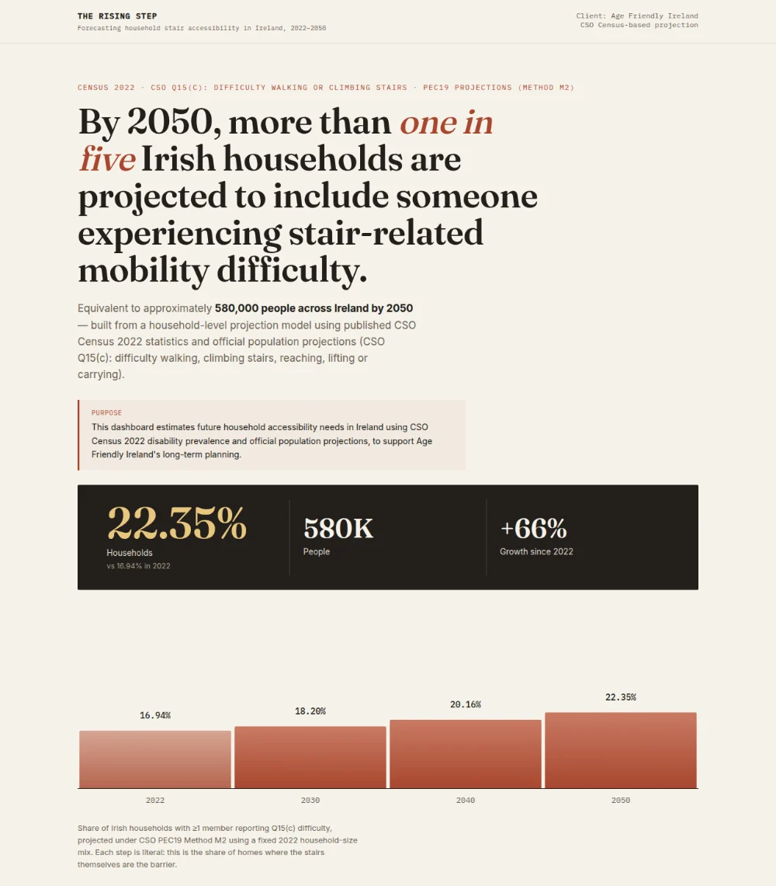
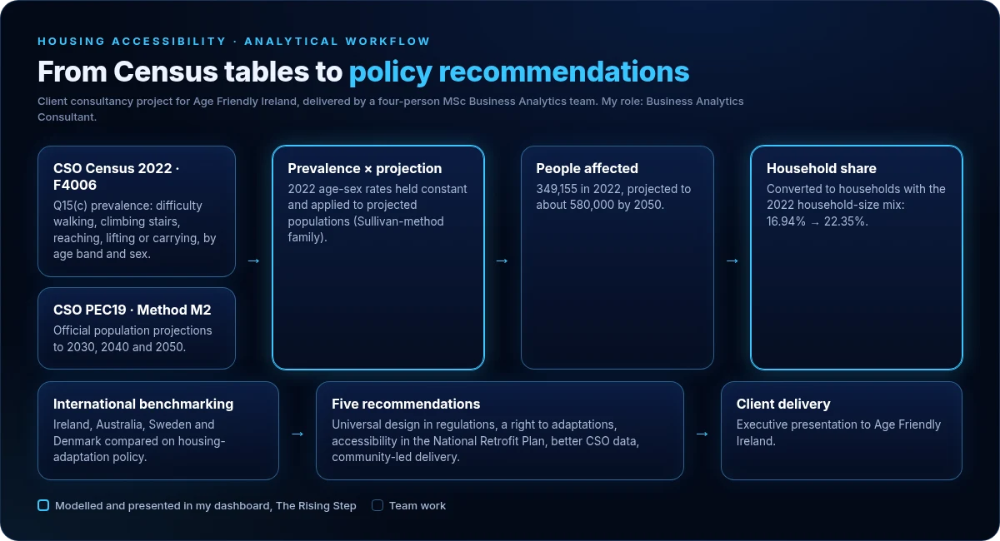
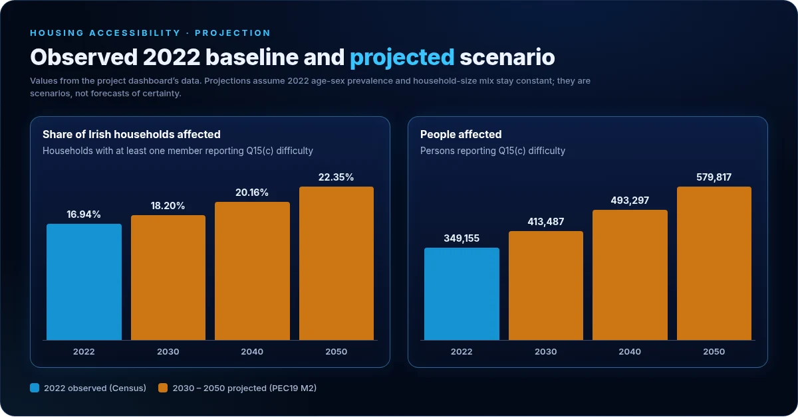

# Housing Accessibility in Ireland: a client project for Age Friendly Ireland

**How many Irish households will include someone who struggles with stairs, and what should national policy do about it?**

MSc Business Analytics consultancy project, Maynooth University · CSO Census 2022 · population projections to 2050 · international policy benchmarking

[**Live dashboard: The Rising Step**](https://age-friendly-ireland.netlify.app/) · [Dashboard source](https://github.com/basant-kumarr/ireland-stair-accessibility-dashboard) · [Portfolio](https://basant-kumar-portfoli.netlify.app/)

  

---

## Client

**Age Friendly Ireland** works with every Irish local authority to make communities more inclusive for older people, including housing, universal design and services that help people age independently.

## The problem

Homes built around stairs become harder to live in as residents lose mobility. Age Friendly Ireland needed a defensible, data-driven estimate of the share of Irish households affected by stair-related mobility difficulty today and in future decades, to inform housing policy, universal design standards and adaptation planning.

## Objective

- Estimate the share of households with at least one member reporting CSO Census question Q15(c) difficulty: walking, climbing stairs, reaching, lifting or carrying.
- Project that share to 2030, 2040 and 2050.
- Benchmark Ireland's housing-adaptation policy internationally and recommend changes.

## My contribution

Four-person team (Basant Kumar, Abhijit Kumar, Pallavi Kethi Reddy, Shanjai Chinnamma Reddy). My role was **Business Analytics Consultant**:

- Chose the projection method: prevalence × projection, rather than time-series forecasting or microsimulation.
- Built [The Rising Step](https://age-friendly-ireland.netlify.app/), the interactive dashboard that presents the projection, its assumptions and its limitations.

International benchmarking, the recommendations and the executive presentation to the client were team work.

## How it works

  

1. **Prevalence.** Q15(c) rates by sex and age band (0–3, 4–64, 65+) from Census 2022 (CSO statistic F4006).
2. **Projection.** The 2022 rates are held constant and applied to official CSO population projections (PEC19, Method M2) for 2030, 2040 and 2050.
3. **Households.** Person-level estimates are converted to the share of households affected, using the 2022 household-size distribution.

**Why this method.** Ireland's Q15(c) wording is too recent to support a reliable time series for ARIMA or ETS models. Dynamic microsimulation would need individual-level transition data that does not yet exist for this Census question. Prevalence × projection uses only published CSO data and can be checked line by line.

## Results

  

| Year | Households affected | People affected |
|---|---|---|
| 2022 (Census, observed) | 16.94% | 349,155 |
| 2030 (projected) | 18.20% | 413,487 |
| 2040 (projected) | 20.16% | 493,297 |
| 2050 (projected) | 22.35% | 579,817 |

- By 2050, more than **one in five** Irish households are projected to include someone with stair-related difficulty.
- Adults aged **65 and over** account for almost all of the projected growth.
- Older women report higher prevalence than older men in every age band.
- The team's client summary also estimated **more than 100,000 additional affected households** by 2050 if policy does not change.

## International policy benchmarking

| Country | Policy model | Key feature |
|---|---|---|
| Ireland | Minimum standards | Part M and Part K building regulations; means-tested adaptation grants |
| Australia | Prevention first | Livable Housing Design Standards mandatory since 2023 |
| Sweden | Rights based | Housing Adaptation Act: a legal right to adaptations |
| Denmark | Community driven | Municipal duty to provide accessible housing |

**Gap identified:** Ireland relies on minimum building standards and reactive grants. It has no universal design law, no guaranteed right to adaptations and no integrated retrofit policy.

## Recommendations delivered to the client

1. Build universal design into new building regulations, moving from reactive to preventive.
2. Establish a legal right to housing adaptations, modelled on Sweden's Housing Adaptation Act.
3. Include accessibility in Ireland's National Retrofit Plan alongside energy efficiency.
4. Improve CSO household-level data on caregiving and housing modification needs.
5. Adopt community-led local delivery of adaptation support, following Denmark.

## Technology and data

| Item | Role in the project |
|---|---|
| CSO Census 2022, statistic F4006 | Q15(c) prevalence by age band and sex |
| CSO PEC19, Method M2 | Official population projections to 2050 |
| Prevalence × projection model | Turns 2022 rates and future populations into people and household estimates |
| HTML, CSS, JavaScript, inline SVG | The dashboard: hand-built charts, no chart library, no build step |
| WHO, Eurostat, ABS, SCB, UNECE sources | International policy benchmarking |

## Limitations

- Prevalence by age and sex is held at 2022 levels; medical and assistive-technology changes are not modelled.
- Migration-related shifts in prevalence are not modelled.
- Household composition is fixed at the 2022 distribution.
- No county-level breakdown, because CSO prevalence data is not published at that resolution.
- These are scenario projections, not certain outcomes.

## Repository contents

| Path | Contents |
|---|---|
| `README.md` | This project write-up |
| `docs/images/` | Figures used above; the projection chart is drawn from the dashboard's data |

The dashboard's source code lives in [ireland-stair-accessibility-dashboard](https://github.com/basant-kumarr/ireland-stair-accessibility-dashboard).

---

**Basant Kumar** · MSc Business Analytics, Maynooth University · [Portfolio](https://basant-kumar-portfoli.netlify.app/) · [LinkedIn](https://www.linkedin.com/in/basantsingh-/) · [GitHub](https://github.com/basant-kumarr)
